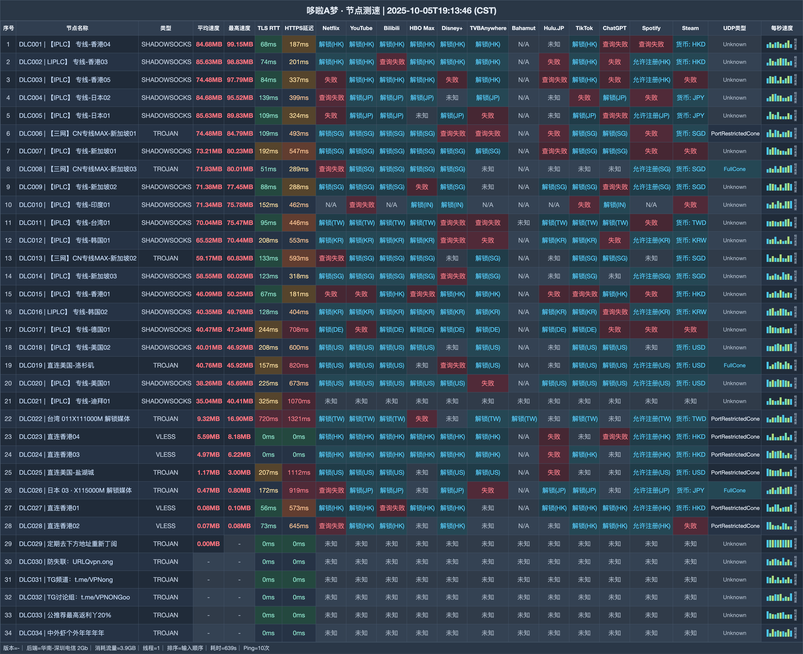

# 哆啦A梦机场测评｜23 元 135G 起，V5 提供 AI 与家宽线路（2026-11-12 更新）

> **先看结论：月付与不限时流量包并列，V5 再补上 AI 专线和家宽节点。**
>
> 👉 **[进入注册页](https://web1.yyds2-doraemon.site/login/register?invite_code=1yjj7VQR)** · 日常两台设备先看 23 元 Vip2；确实需要 V5 线路再升级。

## 哪些人更匹配

- 把 IPLC 与多地区线路放在首位的人
- 需要月付和用完为止流量包的人
- 会使用 V5 AI 专线或家宽节点的人

## 哪些情况建议跳过

- 使用 Vip2 又必须跑 BT 的人
- 准备多人共用 Vip3 及以上个人套餐的人

| 快速判断 | 当前信息 |
|---|---|
| 首档月付 | 135G / 23 元 |
| 月档范围 | 135G—1024G |
| 不限时总量 | 512G—6000G |
| 月档设备 | 2—5 台 |
| 协议组合 | Trojan · VLESS · Shadowsocks |
| V5 线路 | AI 专线 · 家宽 |

**站点定位**：哆啦A梦（doraemon）以 23 元 135G 的 Vip2 起步；V5 档增加 AI 专线、家宽节点，并提供多种不限时总量包。

## 全部套餐怎么排

| 套餐 | 价格 | 流量 | 设备 | 限速 | 说明 |
|---|---:|---:|---:|---:|---|
| Vip2 135G会员 | ¥23/月付 | 135G · 每月订单日重置 | 2 | 目前不限但可能限速 | 禁止BT；无退款 |
| Vip3 230G会员 | ¥34/月付 | 230G · 每月订单日重置 | 3 | 目前不限但可能限速 | 不限制正常BT；禁止共享；无退款 |
| Vip4 350G会员高速 | ¥45/月付 | 350G · 每月订单日重置 | 4 | 目前不限但可能限速 | 不限制正常BT；禁止共享；无退款 |
| Vip5 1024G会员超高速 | ¥90/月付 | 1024G · 每月订单日重置 | 5 | 500M | 原文500M；V5专属AI专线和家宽；不限制正常BT |
| Vip5 512G不限时间 | ¥120/一次性 | 512G · 用完为止 | 不限 | 不限 | 所有节点+V5专属AI专线和家宽；不限制BT；禁止共享 |
| Vip5 1200G不限时间 | ¥240/一次性 | 1200G · 用完为止 | 不限 | 不限 | 所有节点+V5专属AI专线和家宽；不限制BT；禁止共享 |
| Vip5 2400G不限时间 | ¥480/一次性 | 2400G · 用完为止 | 不限 | 不限 | 所有节点+V5专属AI专线和家宽；不限制BT；禁止共享 |
| Vip5 6000G不限时间 | ¥1100/一次性 | 6000G · 用完为止 | 不限 | 不限 | 此档无佣金；不限制BT；禁止共享 |
| 独享海外直播专用定制家宽 | ¥9999/月付 | 10G · 仅能购买一次 | 1 | 1000M | **定制展示项**；不可续费；无偿赞助商务无需付款；禁止BT；测速请错峰；不是普通可购套餐 |

**购买前提醒：**Vip2 禁止 BT；Vip3、Vip4 与不限时档禁止共享。Vip5 月档写 500M，保留原单位。6000G 档没有本站佣金。9999 元定制家宽是展示项，并非普通可购套餐。

## 节点测速图

图表整理出 34 行下载与延迟记录，测试端是 华南-深圳电信 2Gb，采用 1 线程。 图中日期为 **2025-10-05**，完整表格如下：

## 选择顺序

1. 两台设备且不用 BT，可先比较 23 元 Vip2：每月 135G。
2. 三至四台设备对应 Vip3 / Vip4，每月分别 230G / 350G，但不能共享。
3. 长期大流量再看不限时包：512G 120 元起，用完为止；续费本身不重置流量。

## 注册入口

👉 **[打开注册页面](https://web1.yyds2-doraemon.site/login/register?invite_code=1yjj7VQR)** · 日常两台设备先看 23 元 Vip2；确实需要 V5 线路再升级。

*本文含推广链接；通过该入口注册或购买，本站可能获得佣金。*

## 本文更新

- **2026-11-12** — 每日复核：套餐、价格与公告无变化；多账号发布对齐核查完成。
- **2026-11-11** — 每日复核：套餐、价格与公告无变化；多账号发布对齐核查完成。
- **2026-11-10** — 每日复核：套餐、价格与公告无变化；多账号发布对齐核查完成。
- **2026-11-09** — 每日复核：套餐、价格与公告无变化；多账号发布对齐核查完成。
- **2026-11-08** — 每日复核：套餐、价格与公告无变化；多账号发布对齐核查完成。
- **2026-11-07** — 每日复核：套餐、价格与公告无变化；多账号发布对齐核查完成。
- **2026-11-06** — 每日复核：套餐、价格与公告无变化；多账号发布对齐核查完成。
- **2026-11-05** — 每日复核：套餐、价格与公告无变化；多账号发布对齐核查完成。
- **2026-11-04** — 每日复核：套餐、价格与公告无变化；多账号发布对齐核查完成。
- **2026-10-31**：重新编排购买建议与全部套餐，共保留 8 个套餐/展示项。
- **2025-10-05**：节点测速图所示日期。

---
*套餐价格、节点与活动可能调整，付款前请以购买页当时显示为准。*

展开相关搜索词

搜索组合：哆啦A梦、doraemon、哆啦机场、yyds2、哆啦A梦机场、机场测评2026、IPLC机场、代理订阅、哆啦A梦入口、哆啦A梦注册、哆啦A梦测速

